# PlxNative: deten's fork

A personal fork of [PlxNative](https://github.com/GLinnik21/plx-native), the native Plex client
for LG webOS televisions. This page covers what the fork adds. The
[upstream README](https://github.com/GLinnik21/plx-native#readme) and
[plxnative.com](https://plxnative.com/) cover everything else: features, supported televisions,
the official install and troubleshooting.

This is an independent fork. Test builds from it are unofficial, so please report problems with
them here rather than upstream.

## What this fork adds

### Library order (in testing)

You choose one order for your libraries, per profile, and the app uses it in two places:

- **Home** starts with Continue Watching, then shows each library's Recently Added shelf in your
  order, then recommendations and the rest.
- **The Movies and TV Shows tabs** list their library pills in the same order.

Set it in **Settings > Libraries > Library order**. Select a library to pick it up, move it with
Up and Down, then select it again to put it down. Each move saves right away.

| Library order | Moving a library |
|---|---|
| 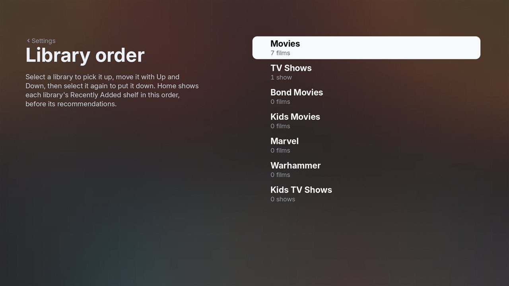 | 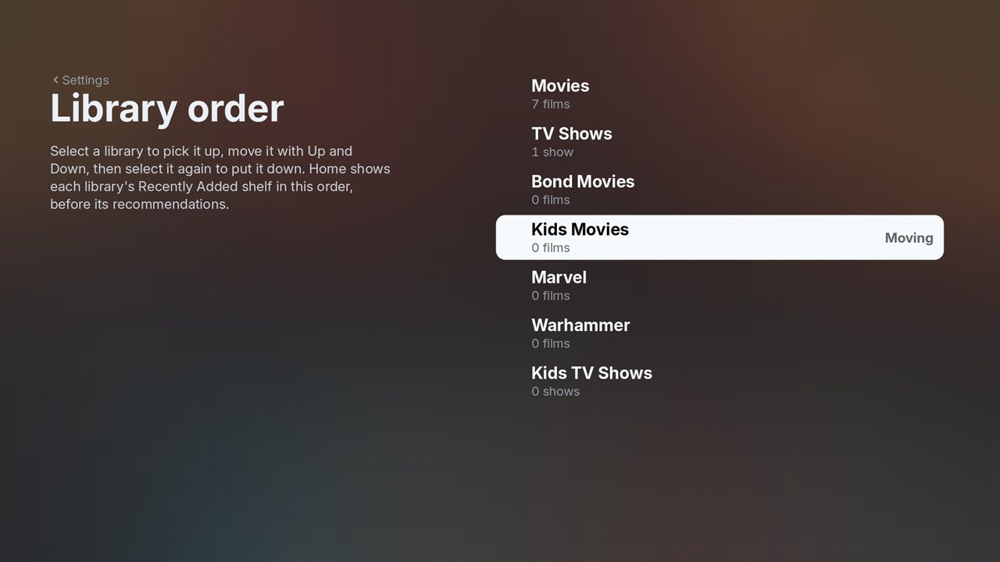 |

| Home after the move | Movies tab after the move |
|---|---|
| 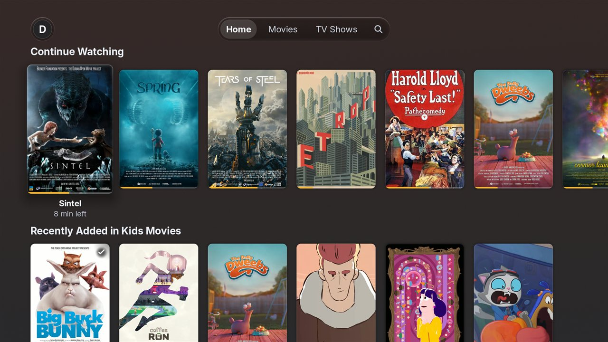 | 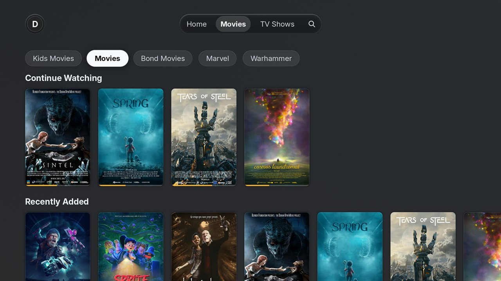 |

*The screenshots come from the project's simulator and its openly licensed demo films.*

Good to know:
- Home reorders the Recently Added shelves your server sends. A library your server leaves off its
  home screen stays off Home.
- Shelf headings use the server's wording, such as "Recently Added in Kids Movies".
- Movies and shows share one list.

Code: branch [`library-order`](../../tree/library-order).

### Subtitle auto-sync (built, testing on a real server)

Plex Media Server can re-time an external subtitle to match the dialogue, the same feature Plex's
own apps call "Auto Sync Subtitles". This fork asks the server for the synced copy whenever the
server says it can provide one, and falls back to the original file otherwise.

In the player, open **Subtitles**. For an external subtitle that your server can sync, an
**Auto-sync** toggle appears (on by default) with a note saying whether the server synced it.
Switching it re-fetches the subtitle straight away.

It needs a Plex Pass server that has analysed the film for voice activity. It works with external
subtitle files, including ones downloaded through the app's subtitle search. Subtitles inside the
video file, and subtitles the server burns into a transcode, keep their original timing; the
existing manual **Timing** control still adjusts those.

Code: branch [`subtitle-autosync`](../../tree/subtitle-autosync), which builds on `library-order`.

### Recommended or All, per library (in testing)

Each library now has two views, picked from a small **Recommended | All** row under its pill:

- **Recommended** is the regular page: the server's shelves, then the full list further down.
- **All** goes straight to the full list, with Type, Sort, Filter and the A to Z rail at the top.

The row follows the library pill you are on. Move to **Kids Movies**, press Down, and choose
**All** to open every Kids Movie in one step. Selecting a pill directly opens it the usual way.
On a library page, Channel Down (or Page Down) jumps from the pills or shelves to the full list.

**Settings > Libraries > Library opens on** decides the starting view:

- **Default** opens every library on Recommended.
- **All** opens every library on its full list.
- **Last** reopens each library on the view you last chose for it.

| Choosing All for Kids Movies | Kids Movies selected |
|---|---|
| 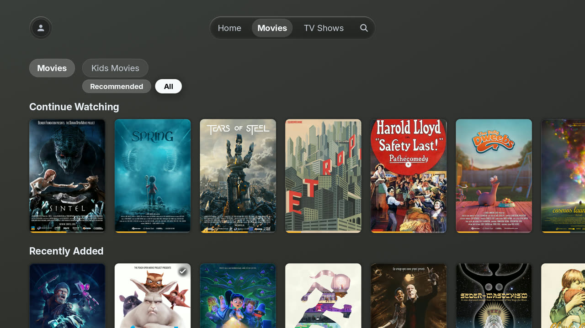 | 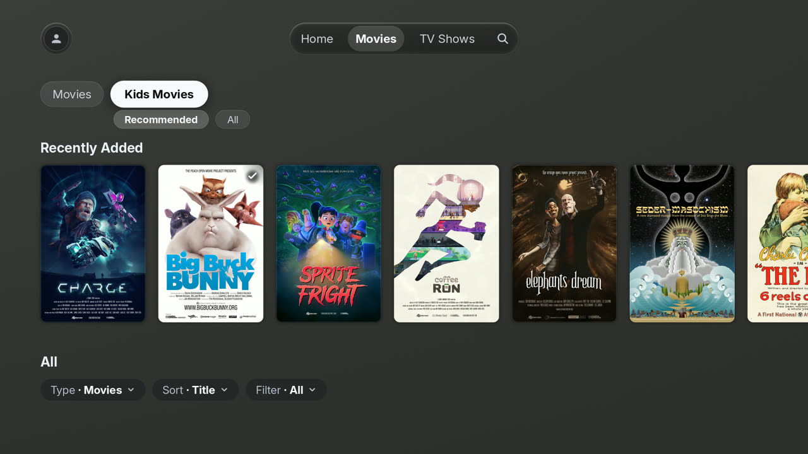 |

| The All view | Library opens on |
|---|---|
| 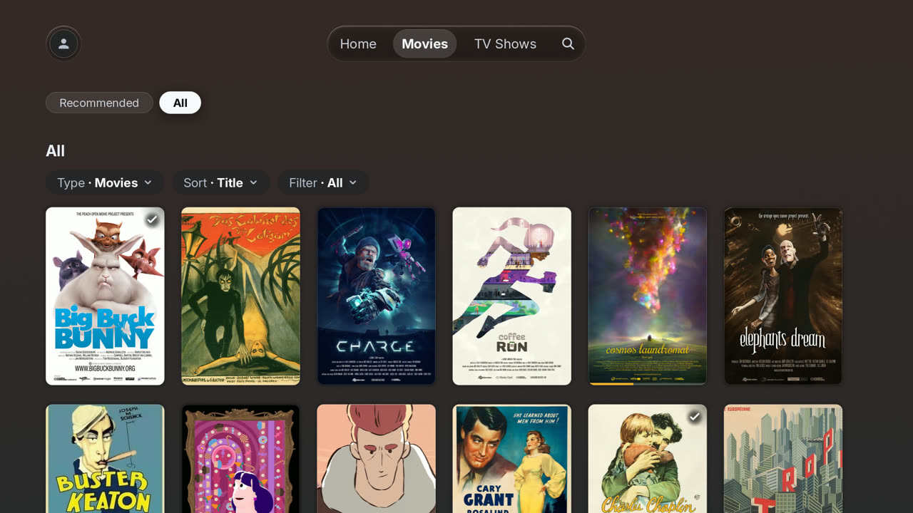 | 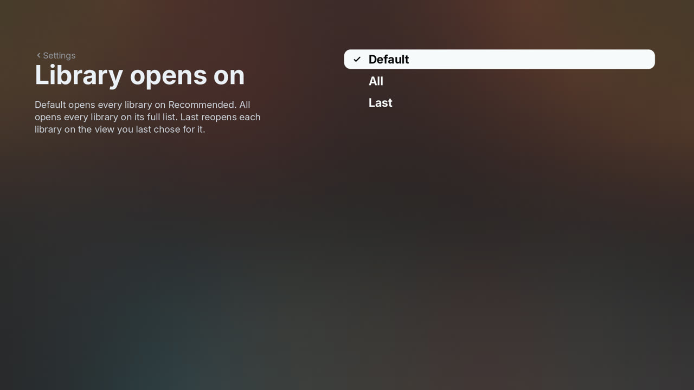 |

### Skip intro and credits

**Settings > Playback** has **Skip intro** and **Skip credits**, each with three choices:

- **Show button** (the default) offers the Skip button as before.
- **Automatically** skips as soon as the server's marker starts. Automatic credit skipping starts
  the next episode right away, or ends playback after a film or a show's last episode.
- **Off** hides the button for that kind.

Automatic skipping only acts on markers your server has detected.

### Audio and subtitles remembered per show

Choose an audio track or subtitle in the player, including turning subtitles off, and later
episodes of the same show start with the matching track. The choice is kept per profile and
matched by language and type, since every episode numbers its tracks differently. Forced
subtitles and full subtitles stay separate, and an audio description track only replaces the main
audio when you picked one.

### Shuffle (in testing)

Hold OK on a show for **Shuffle Show**, which plays episodes from every season in random order,
or on a season for **Shuffle Season**. The season tabs on a show's page offer both. Up Next keeps
following the shuffled order until you play something else.

Code: branch [`library-views`](../../tree/library-views) holds the four sections above, built on
`subtitle-autosync`.

### Watchlist (in testing)

The top bar now reads **Home, Movies, TV Shows, Watchlist**, then Search. The Watchlist page shows
your Plex Watchlist for the profile you are signed in as, newest first.

- **Titles on one of your servers** show that server's poster and progress. Select one to open its
  usual page, where Play and Resume work as always.
- **Titles on none of your servers** appear dimmed with **Not on your server**. Selecting one opens
  a short summary with a **Remove from Watchlist** button.
- **Movie and show pages** have an **Add to Watchlist** button at the end of the button row. It
  changes to **Remove from Watchlist** once the title is on the list.
- **Hold OK** on a Watchlist poster for **Remove from Watchlist**.

Each Plex Home profile sees its own Watchlist. Plex keeps a Watchlist for profiles that sign in
with their own Plex account, so other profiles see a short message on the page and no button on
detail pages. The Watchlist comes from Plex's online service, the same one the app already uses
for cast biographies.

| Watchlist page | A title on none of your servers |
|---|---|
| 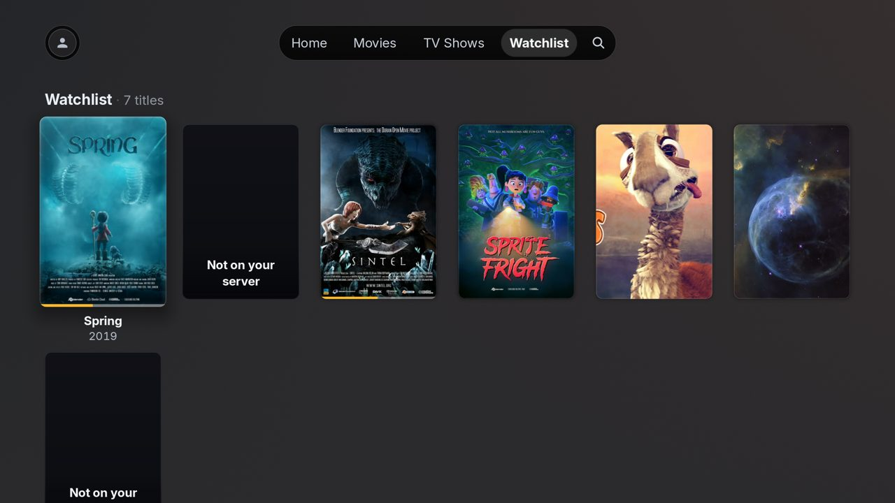 | 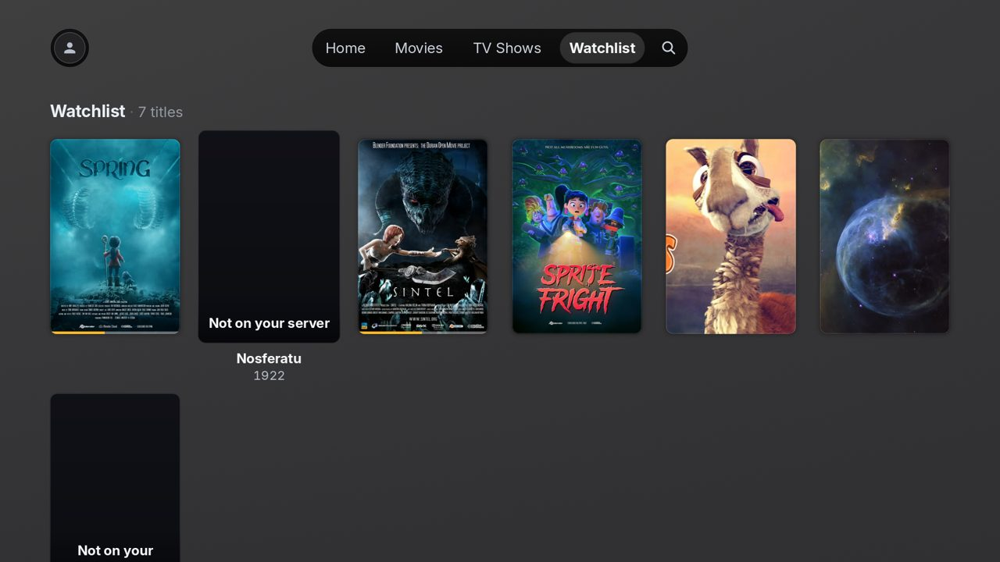 |

| Detail page button |
|---|
| 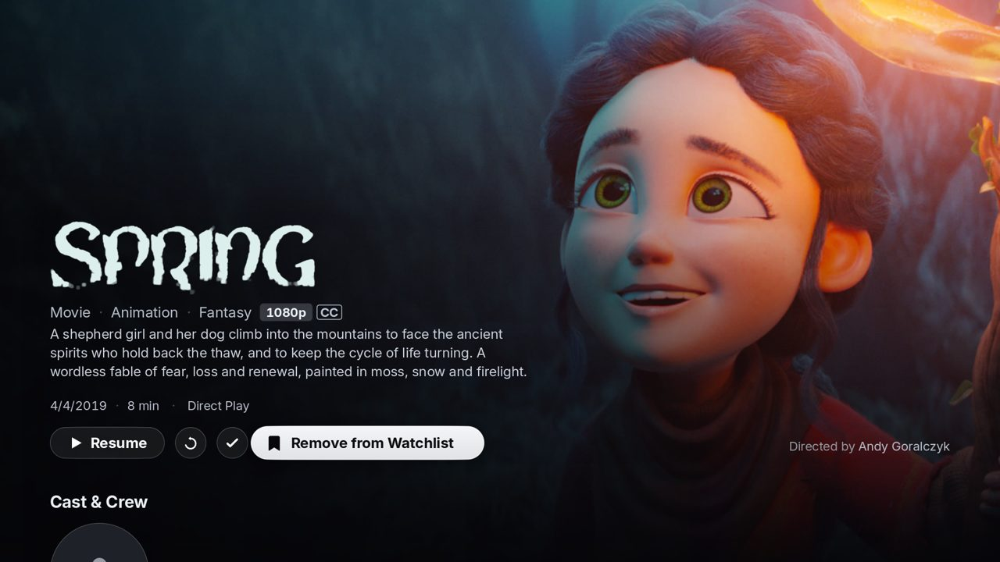 |

Code: branch [`watchlist`](../../tree/watchlist), built on `library-views`.

## Try a test build

Test builds are published as [pre-releases](../../releases). They use the **debug** flavour, which
installs as its own app, **PlxNative debug** (`com.beb.plxnative.debug`), with its own launcher
tile and sign-in. It sits alongside your regular PlxNative and the official Plex app.

On a rooted television with Homebrew Channel, install the `.ipk` from a release. To remove it,
uninstall **PlxNative debug** like any other app.

The newest test build, [Test 7](../../releases/tag/test-7), carries every feature above. Test
builds are compiled the release way, so the on-screen frame counter that debug builds show is
left out.

Test builds also keep a playback log at `/tmp/com.beb.plxnative.debug/plxnative-history.log`
(capped at 2 MB, kept across app restarts, cleared when the television restarts). Each episode or
film records why it ended, such as reaching the end, the Up Next countdown or Back, which helps
when reporting playback problems.

## Building

Builds use upstream's own pipeline. The `CI` workflow's cross-build job makes the debug `.ipk` on
GitHub's ARM runners; run it from the Actions tab on the branch you want. Local builds need a Mac
or an arm64 Linux machine, as described in the [install guide](docs/install-and-verify.md).

## License

GPL-3.0, the same as upstream. See [LICENSE](LICENSE) and [LICENSING.md](LICENSING.md).
